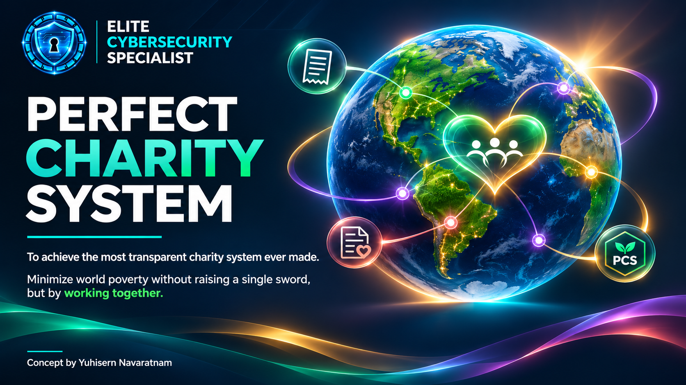
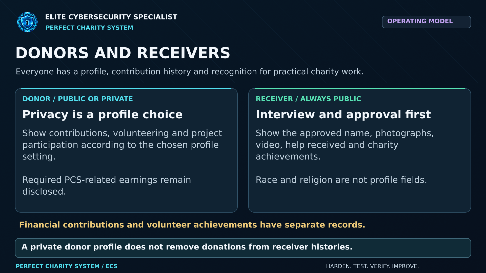
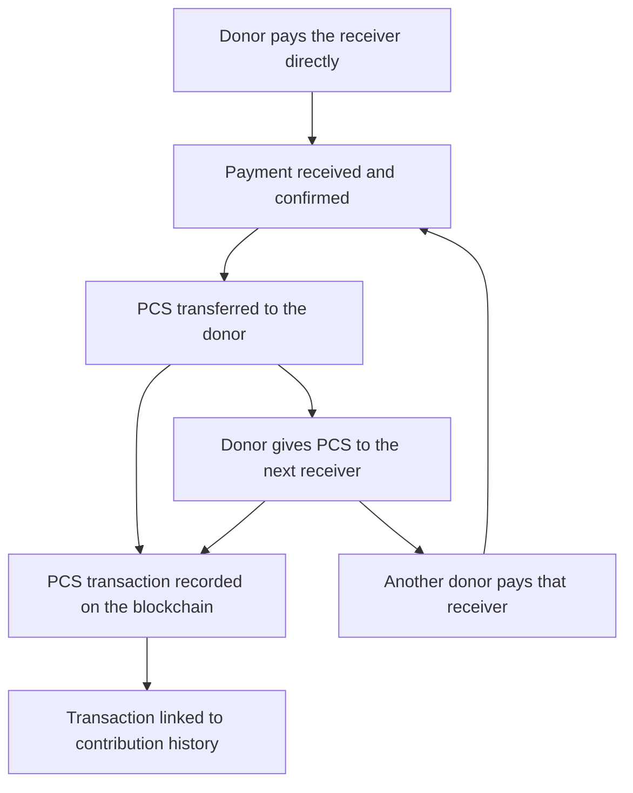
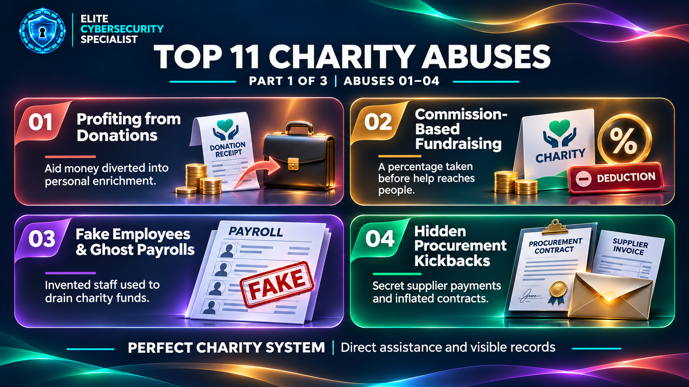
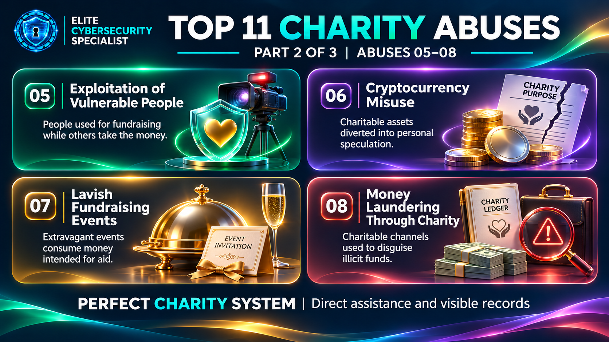
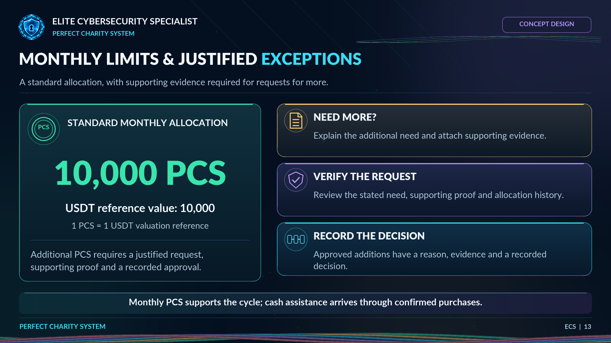
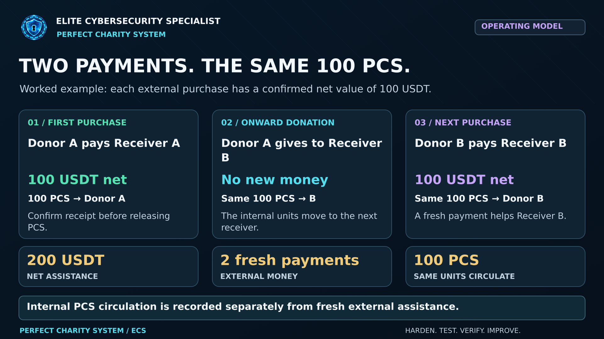
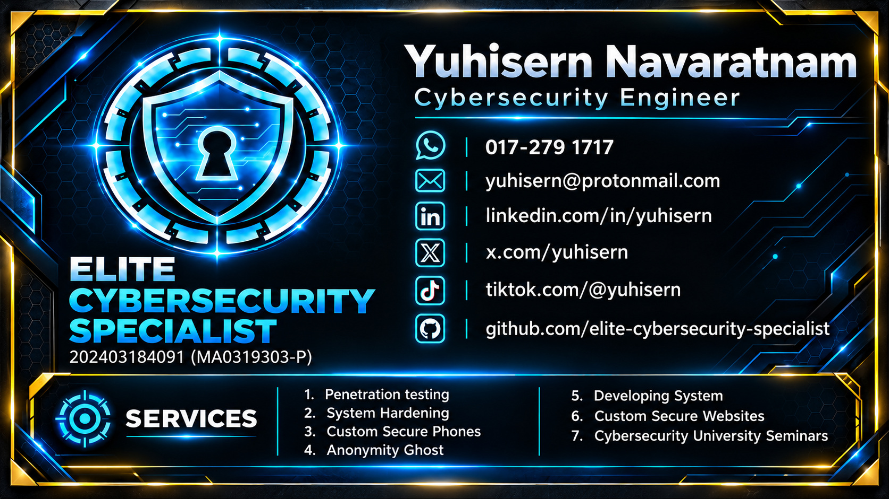

  

# Perfect Charity System (PCS)

**A blockchain-based charity system that connects donors directly with people in need and keeps a transparent record of their contributions.**

Perfect Charity System is an initiative by **Elite Cybersecurity Specialist**. It is designed to eliminate charity crimes through direct donations, blockchain records and public accountability. The goal is to build the world’s most transparent charity system and minimise global poverty by working together, without raising a single sword. The platform is designed to be simple for everyone to use.

**Everyone has a profile. Donors can choose public or private profiles. Receiver profiles are strictly public.** Profiles bring together photographs, videos, donations, volunteering and participation in charity projects.

> **Self-funded · Approximately 5% complete.** This README explains the intended PCS system. The repository contains the prototype source, sample interfaces and project documentation. Development is continuing.

[Profiles](#1-everyone-has-a-profile) · [Blockchain records](#2-blockchain-records-connect-the-system) · [Who receives help](#3-who-can-receive-assistance) · [Eleven abuses and public challenge](#4-the-charity-abuses-pcs-is-designed-to-address) · [Monthly PCS](#5-monthly-pcs-allocation) · [Direct payments](#6-how-donors-pay-receivers-directly) · [The donation cycle](#7-how-the-pcs-donation-cycle-continues) · [Funding](#8-three-separate-funding-purposes) · [External Services](#9-external-services-and-volunteering) · [Governance](#10-directors-and-public-earnings) · [Oversight](#11-verification-and-country-inspectors) · [Connected protections](#12-how-the-rules-work-together) · [Vision and development](#13-the-vision-and-development) · [Questions](#14-frequently-asked-questions)

## 1. Everyone has a profile

The public participants in PCS are called **Donors** and **Receivers**. Everyone has a profile so that people can understand whom they are helping and see a record of charitable activity.

| Profile | Visibility | What it shows |
| --- | --- | --- |
| **Donor** | Public or private, chosen by the donor. | The donor’s introduction, contributions, volunteering and participation in charity projects, subject to the profile’s visibility setting. |
| **Receiver** | Strictly public. | The approved receiver’s name, photographs, video, contributions received and charity activities. |

People can share photographs and videos, introduce themselves and document their charity work. Their profiles can show:

- **Donations:** whom they helped and the contributions recorded through PCS.
- **Help received:** who supported the receiver and the assistance recorded.
- **Volunteering:** activities, service and achievements.
- **Charity projects:** participation in projects listed under **External Services**.

Receiver contribution histories show who donated to them. A donor’s private profile restricts access to that profile; it does not remove contributions from receiver histories or remove the duty to disclose PCS-related earnings.

Financial contributions and volunteer achievements are displayed separately. Both deserve recognition, and readers should be able to tell them apart.

## 2. Blockchain records connect the system

**Blockchain provides the transaction history for PCS.** It connects recorded PCS transfers with confirmed payments and the participants involved.

The process is straightforward:

1. A donor pays an approved receiver through an available external payment provider.
2. The receiver or authorised PCS team confirms that the payment was received.
3. The corresponding PCS transfer is recorded in the blockchain history.
4. Further PCS donations create further recorded transactions.

**Money and PCS have different roles.** Banks and external payment providers process money directly to the receiver. PCS records the charity workflow and the internal PCS transactions connected to it.

PCS is the system’s internal charity unit, sometimes called **“dead crypto”**. It can be purchased from approved receivers and donated within PCS. It cannot be traded on an external cryptocurrency exchange.

The valuation reference is **1 PCS = 1 USDT**. Participants can use an available local-currency payment method; they do not have to pay in USDT. The PCS amount follows the confirmed value received after any provider deductions.

The reference describes the unit’s value within this model. It does not mean that every allocation is backed by a USDT reserve or can be redeemed through an outside exchange.

### Transaction history stays intact

The original transaction remains in the history. If management approves a correction, it uses a **new recorded PCS transfer** back to the donor, without a PCS return-transfer charge. The reason and approval are linked to the original record.

Any handling of the original external payment follows the payment provider’s process and is recorded separately.

## 3. Who can receive assistance

Individual receivers belong to one of these seven categories:

| Category | Who it includes |
| --- | --- |
| **1. Disabilities or special conditions since birth** | People born with disabilities or special conditions. |
| **2. Acquired physical disabilities** | People who became physically challenged. |
| **3. Serious diseases** | People suffering from serious diseases. |
| **4. Abandoned elderly or homeless individuals** | Older or homeless people needing assistance. |
| **5. Orphans under 21** | Young people without parental care, below the age of 21. |
| **6. Single mothers** | Unmarried, low-income mothers with children. |
| **7. Verified refugees** | Refugees with verified good conduct and behaviour. |

**Receivers must be interviewed and approved by a PCS representative before an assistance account is opened.** Their profiles are public and include their name, photographs and video. The internal team helps people who cannot participate independently.

**Race and religion are not profile fields or assistance categories.**

Approved existing charity organisations can also receive support. They are considered separately from the seven individual categories and must accept PCS operating rules and transparency requirements.

## 4. The charity abuses PCS is designed to address

The PCS team has researched **11 forms of charity crime and abuse**, including how registered charity organisations can exploit loopholes to divert donations, conceal earnings and benefit the people controlling the money.

These abuses harm donors and the vulnerable people they intended to help. Charity should provide assistance, dignity and opportunity.

**Perfect Charity System is designed to eliminate these abuses through direct donations, blockchain records, public accountability and strict financial rules.** Public support is essential to build the system, put it into practice and uphold its standards.

People who investigate financial abuse and challenge established practices must be able to work safely and independently. We ask the public to support our team’s safety, privacy and freedom from intimidation as we develop PCS.

**If we do not take action, who will?**

### A public challenge

**We welcome a public challenge.** If you have a better solution, present it openly. Explain how it addresses these eleven abuses, protects receivers, keeps assistance separate from running expenses and makes charitable spending traceable. We welcome constructive criticism that helps improve the system.

PCS is currently **self-funded and 5% complete**. Supporting its development means sharing the concept, examining its rules and contributing the skills needed to build, test and maintain it.

### Abuses 1–4

| Abuse | How it happens | The PCS response |
| --- | --- | --- |
| **1. Profiting from donations** | Assistance is diverted into personal enrichment. | Direct receiver payments, separate operating funding and the directors’ no-profit rule. |
| **2. Commission-based fundraising** | A percentage is taken before help reaches the receiver. | PCS takes no fundraising commission or transaction cut. |
| **3. Fake employees and ghost payrolls** | Invented workers are used to drain charity funds. | Approved work, staff payments and relevant earnings must be identifiable and disclosed. |
| **4. Hidden procurement kickbacks** | Secret payments and inflated costs benefit connected people. | Suppliers, costs, relationships and relevant earnings must be recorded and reviewed. |

### Abuses 5–8

| Abuse | How it happens | The PCS response |
| --- | --- | --- |
| **5. Exploitation of vulnerable people** | People are used to raise money that others keep. | Interviewed receivers have their own public profiles, direct assistance and support from the internal team. |
| **6. Cryptocurrency misuse** | Charity assets are diverted into personal speculation. | Internal PCS remains within the charity workflow and is not traded on outside exchanges. |
| **7. Lavish fundraising events** | Event costs consume money intended for assistance. | Receiver assistance does not pay running or event costs; separately funded spending remains accountable. |
| **8. Money laundering through charity** | Charitable channels are used to disguise illicit funds. | Verified participants, actual payment checks, recorded transactions and authorised inspection support investigation and enforcement. |

### Abuses 9–11

| Abuse or loss | How it happens | The PCS response |
| --- | --- | --- |
| **9. Profiteering under charity structures** | A charity organisation is used for private enrichment. | Partners must accept transparency requirements, disclose relevant earnings and follow the directors’ prohibition where applicable. |
| **10. Third-party payment deductions** | External provider charges reduce the amount received. | Show the charges clearly and calculate PCS from the confirmed amount received. PCS takes no transaction cut. |
| **11. Sexual exploitation linked to fundraising** | Fundraising or aid relationships are used to exploit people. | Exploitation is prohibited; safeguarding, reporting and investigation form part of the operating practices. |

External payment-provider fees are costs and are not automatically crimes. They should be clearly identified when the donor chooses a payment method.

## 5. Monthly PCS allocation

**The standard monthly receiver allocation is 10,000 PCS, using the 1 PCS = 1 USDT valuation reference.**

A receiver who needs additional PCS must:

1. Explain the need.
2. Provide supporting documents or other evidence.
3. Receive approval following a review.

The request, reason, evidence, decision and additional allocation must be recorded.

The monthly allocation, the receiver’s accumulated PCS balance and the money received are separate records. Receivers can hold an accumulated PCS balance. Money reaches a receiver when a donor makes a confirmed purchase.

The prototype contains monthly credit and manual addition functions. The complete request, evidence and approval process still needs to be finished and tested.

## 6. How donors pay receivers directly

### Step 1: Choose a receiver

Read the public profile of an approved individual or charity organisation. Review their introduction, needs and contribution history.

### Step 2: Choose a payment method

Choose an available bank or external payment provider, such as PayPal, Stripe or Western Union, where supported.

> **Your bank or payment provider may charge a fee. PCS takes no commission.**

### Step 3: Pay the receiver

The external provider processes the payment to the receiver’s designated account. PCS does not operate its own fiat payment gateway.

### Step 4: Submit the receipt and confirm payment

Upload the payment evidence through PCS. The receiver or authorised PCS team checks that the money was actually received.

### Step 5: Transfer PCS to the donor

After confirmation, the corresponding PCS moves from the receiver’s balance to the donor’s balance. The amount follows the confirmed value received after any external deductions.

**The same external payment cannot be used twice to obtain PCS.** The payment reference, original payment time, amount and destination must be checked. Uploading the same receipt again does not make it a new payment.

The original payment time and the receipt upload time are different records. Fees, the original currency, any conversion rate and the resulting PCS amount must also be clear.

## 7. How the PCS donation cycle continues

Buying PCS already helps the receiver who receives the direct payment. The donor can then pass the PCS to another approved receiver, allowing another donor to continue the cycle.

1. **Donor A buys PCS from Receiver A.** Donor A pays Receiver A directly. After confirmation, Receiver A transfers the corresponding PCS to Donor A.
2. **Donor A donates PCS to Receiver B.** Receiver B now has those units available to sell.
3. **Donor B buys PCS from Receiver B.** Donor B makes a new direct payment to Receiver B. After confirmation, the corresponding PCS transfers to Donor B.
4. **Donor B can donate PCS onward.** The cycle can continue with another receiver and another donor.

### One simple example

In this example, each purchase has a confirmed net value of **100 USDT**. Participants may make the actual payment in local currency through their chosen provider.

| Step | Money received | PCS transferred |
| --- | --- | --- |
| Donor A purchases from Receiver A. | Receiver A receives a net value of 100 USDT. | Receiver A transfers 100 PCS to Donor A. |
| Donor A donates to Receiver B. | No new money payment occurs at this step. | Donor A gives the 100 PCS to Receiver B. |
| Donor B purchases from Receiver B. | Receiver B receives a fresh net value of 100 USDT. | Receiver B transfers the 100 PCS to Donor B. |

**The two receivers have received a total net value of 200 USDT from two separate purchases.** The internal PCS transfers have their own records and are not counted again as additional money received.

Each new payment comes from the next buyer. A receiver receives money when another donor purchases PCS from them.

## 8. Three separate funding purposes

PCS keeps three purposes separate so that people can see what their support pays for.

| Purpose | What it supports | What must be recorded |
| --- | --- | --- |
| **Direct assistance** | Individuals in the seven categories and approved charity organisations. | Assistance received, related PCS transactions and contribution histories. |
| **Internal operations** | Hosting, security, maintenance, verification, approved staff and help for participants. | Separately donated operating support, expenses, staff payments and available balance. |
| **External Services projects** | Approved physical aid projects and their delivery costs. | Responsible profiles, budgets, suppliers, spending, delivery and relevant earnings. |

**Money donated to help receivers does not pay PCS running expenses.** Companies and individuals can support internal operations through separate donations.

Approved staff and service providers can be paid for legitimate work from the relevant separate funding. Their work, payments and PCS-related earnings must be disclosed. The model allows properly funded, disclosed staff payments; it does not claim that everyone works without pay.

## 9. External Services and volunteering

**External Services is the section for approved charity projects and practical assistance.** Projects can include food distribution, medical outreach, shelter, homes, water and other approved aid.

Each project has:

- A clear purpose and a responsible profile.
- A budget and supporting documents.
- Records of suppliers, spending and delivery.
- Disclosure of relevant payments and participants’ PCS-related earnings.
- A record of the people who volunteered or participated.

Participation becomes part of the person’s charity achievements on PCS. People can document their work through photographs, videos and project updates. Their profiles recognise practical service alongside financial contributions.

## 10. Directors and public earnings

**PCS does not profit from donations. Directors cannot profit from any donation, directly or indirectly.**

This rule covers receiver assistance, internal operating donations and External Services project donations. Connected suppliers, intermediaries or other people cannot be used to bypass it.

**All participants’ PCS-related earnings must be publicly disclosed through their profiles and relevant records.** A private donor profile does not remove this requirement.

Approved staff and providers may receive legitimate payments for their work from the appropriate separate funding. The records must identify the work, payments, project costs and relevant relationships.

Public disclosure does not give directors permission to profit from donations. Receiver assistance, work-related earnings and expense reimbursements must be identified clearly rather than mixed into one unexplained figure.

No hidden commissions, undisclosed fees or private deductions are permitted. Partners are selected only if they accept the required operating practices.

## 11. Verification and country inspectors

**Each country can have only one inspector account. Its actions must be recorded.**

Inspector accounts are restricted oversight accounts, separate from public donor and receiver profiles. They are intended to support authorised government and law-enforcement inspection. Keeping an inspector’s profile hidden from the public does not hide its actions from authorised review.

The internal team helps receivers under assigned permissions. Management can review exceptional actions without creating a second inspector account for the country.

### All authorised collections follow PCS

Banks and external providers process the payments, while the charitable activity follows the PCS workflow and is recorded through PCS.

Representatives and partners must not collect unrecorded cash, accept undisclosed side payments or run separate charity collections outside this workflow. **PCS treats such unauthorised collections as theft under its operating rules.** Breaches are grounds for investigation, suspension and removal, with the relevant records preserved.

### Check that the records agree

Payment evidence, actual receipt confirmation, PCS transactions and project spending must be checked against one another. This helps identify missing money, repeated payment claims and unexplained differences.

Receiver approval, additional allocations, corrections and inspector actions must also have identifiable records. The original transaction stays in the history when a correction is made.

## 12. How the rules work together

**The protections work as one connected system.** Each step gives the next step something to check.

| What happens | The rule that provides accountability |
| --- | --- |
| A person seeks help. | A representative interviews and approves the receiver’s public profile. |
| PCS is allocated. | The monthly amount is defined; additional requests require a reason, evidence and recorded approval. |
| A donor chooses a receiver. | The receiver’s information and contribution history help the donor make an informed choice. |
| Money is paid. | The chosen external provider processes it directly to the receiver’s designated account. |
| PCS is transferred after payment. | Actual receipt is confirmed, and the same payment cannot be used for another completed transfer. |
| PCS is donated onward. | The transfer is recorded; the next money payment comes from another buyer. |
| Staff or project costs are paid. | The correct funding purpose, costs and relevant earnings must be disclosed. Directors still cannot profit. |
| An inspector acts. | The action is recorded and available for authorised review. |

For the donor, participation stays simple: **choose a receiver, pay directly, submit the receipt, receive confirmed PCS and optionally donate it onward.**

PCS brings direct assistance, public charity histories, volunteer achievements, separate operating support, earnings disclosure and recorded oversight into one model. Its long-term ambition is to set a world-record standard for charitable transparency through an operating system and results people can examine.

## 13. The vision and development

Yuhisern Navaratnam conceived Perfect Charity System in his early twenties. Now 38, he knows the people he will bring into the future NGO to build, execute and maintain this revolutionary system.

The aim is to make overlooked people easier to find and support, give donors a clear record of their help and recognise people who give their time and skills to charity.

**PCS is self-funded and approximately 5% complete.** The future NGO, operating model and intended features are part of the development vision.

The repository contains prototype code and sample interfaces for registration, profiles, purchase requests, receipts, confirmation, wallets, transaction records, monthly PCS credits, manual additions, projects and inspector tools. Integration, enforcement of the full operating rules and testing remain development work.

### Explore the project

| Topic | Documentation |
| --- | --- |
| Donation cycle and accounting | [PCS model](documentation/pcs-model.md) |
| Governance and operating rules | [PCS governance](documentation/pcs-governance.md) |
| Proposed technical safeguards | [Simple controls](documentation/pcs-simple-controls.md) |
| Implementation work | [Development status](documentation/development-status.md) |
| Architecture and source responsibilities | [Implementation](documentation/implementation.md) |
| Folder and file guide | [File purposes](documentation/filepurpose.md) |
| Sample interfaces | [templates/](templates/) |
| Application source | [codes/](codes/) |
| Local development setup | [Deployment](documentation/deployment.md) |
| Production preparation | [Production readiness](documentation/production.md) |
| Existing-checkout update instructions | [Update GitHub](UPDATE-GITHUB.md) |

The documentation describes the concept and the work required to complete it. The current source and sample interfaces remain a prototype.

## 14. Frequently asked questions

**Can donors choose a private profile?**  
Yes. Donors choose a public or private profile. Receiver profiles remain strictly public. Private donor profiles do not remove contributions from receiver histories or remove required earnings disclosures.

**Can receivers create their own assistance accounts?**  
A PCS representative must interview and approve the receiver first. The internal team helps people who cannot participate independently.

**Why buy PCS instead of only making an ordinary payment?**  
The purchase helps the receiver directly. It also gives the donor internal PCS that can be donated to another approved receiver, allowing another donor to continue the cycle.

**Must donors pay in USDT?**  
No. Participants choose an available external payment method. The 1 PCS = 1 USDT reference is used to value the internal unit.

**How will local-currency conversion work?**  
PCS needs one published conversion policy, with the rate, source and time recorded for each payment. The final conversion source remains an implementation decision, and actual provider charges must be visible.

**Are all payments free of charges?**  
PCS takes no transaction cut. The bank or payment provider may charge fees. The PCS amount follows the confirmed value the receiver receives after any deductions.

**Does a monthly allocation mean the receiver has already received money?**  
The monthly allocation adds internal PCS. The receiver receives money when another donor makes a confirmed purchase from them.

**Does holding PCS guarantee an immediate payment?**  
A receiver receives money when a buyer pays them. The timing depends on donor participation and available payment methods.

**How are repeated payment submissions handled?**  
The original payment reference, time, amount and destination must be checked. One external payment can support only one completed PCS transfer. The proposed technical safeguards are explained in [Simple controls](documentation/pcs-simple-controls.md).

**Can records be erased to correct a mistake?**  
The original record stays in the history. A management-approved correction creates a new linked PCS transfer, with the reason and approval recorded and no PCS return-transfer charge.

**Can people receive payment for legitimate work?**  
Approved staff and providers can be paid from the appropriate separate funding, with their work and earnings disclosed. Directors cannot profit from donations, directly or indirectly.

**Can existing charity organisations participate?**  
Yes, if approved and willing to follow PCS operating rules and transparency requirements. They must record the relevant charitable activity through PCS and disclose the required costs and earnings.

## Connect with Elite Cybersecurity Specialist

**Yuhisern Navaratnam** — Cybersecurity Engineer 
**Elite Cybersecurity Specialist** | Malaysia 
**SSM:** 202403184091 (MA0319303-P)

  

**Email:** [Yuhisern@protonmail.com](mailto:Yuhisern@protonmail.com) 
**WhatsApp:** [+60 17-279 1717](https://wa.me/60172791717) 
**GitHub — Perfect Charity System:** [Official repository](https://github.com/elite-cybersecurity-specialist/perfectcharitysystem) 
**GitHub — ECS projects:** [Elite Cybersecurity Specialist](https://github.com/elite-cybersecurity-specialist) 
**Company profile:** [ECS company profile](https://github.com/elite-cybersecurity-specialist/company-profile) 
**Blogspot:** [Elite Cybersecurity Specialist](https://elite-cybersecurity-specialist.blogspot.com/) 
**TikTok:** [@yuhisern](https://www.tiktok.com/@yuhisern) 
**LinkedIn:** [linkedin.com/in/yuhisern](https://www.linkedin.com/in/yuhisern/) 
**X:** [x.com/yuhisern](https://x.com/yuhisern)
