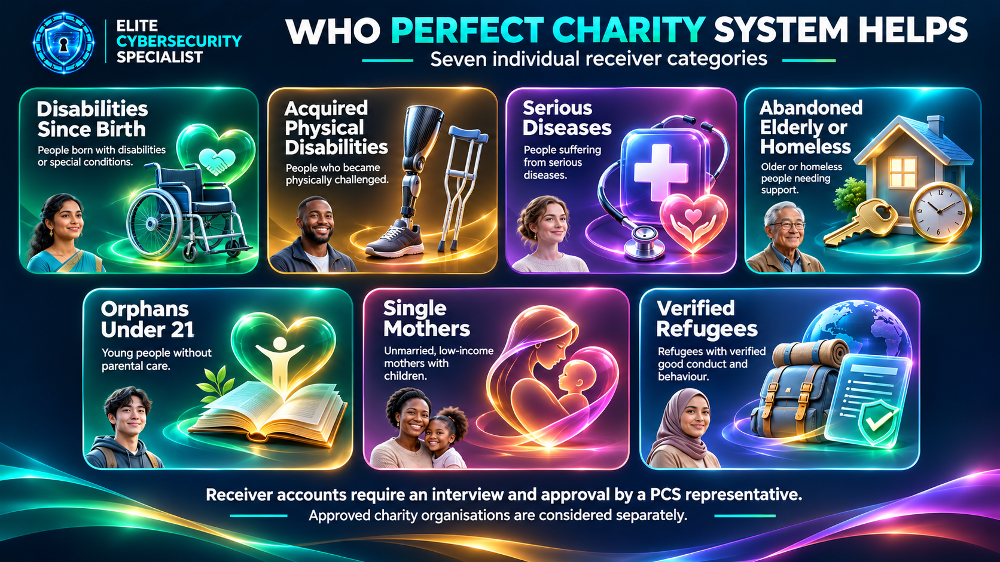
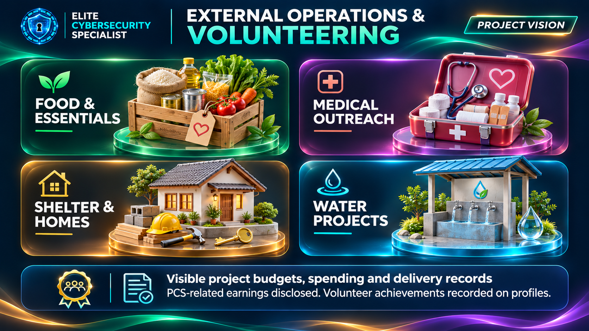
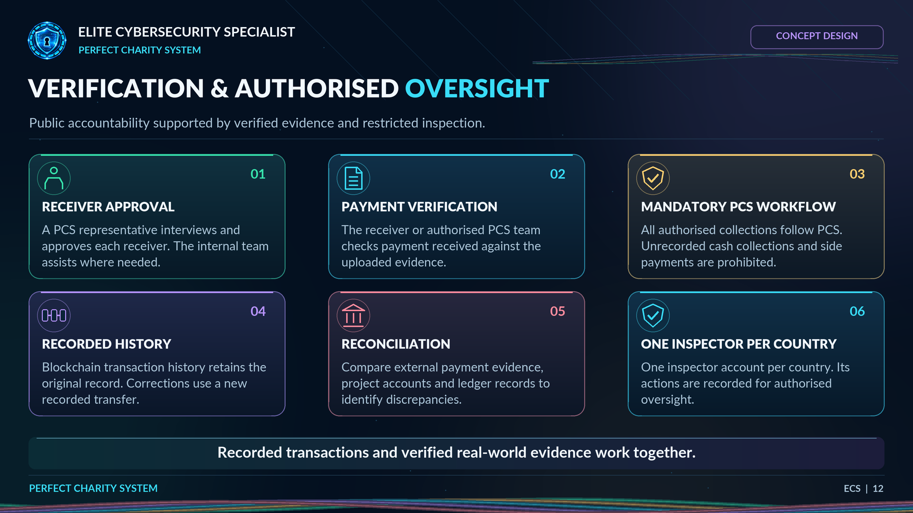
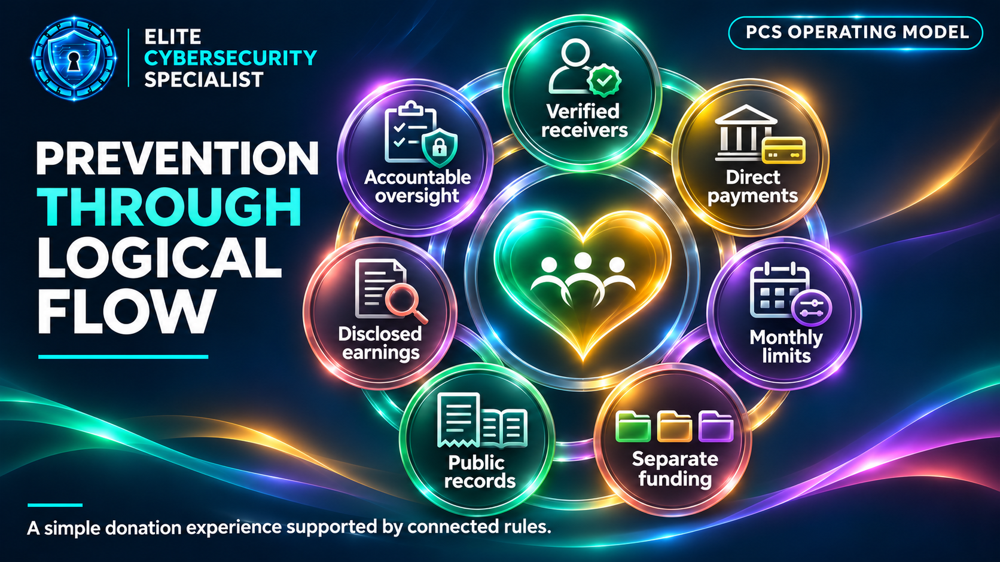

  

# Perfect Charity System (PCS)

**Each purchase pays a receiver directly. The internal PCS can then be donated onward, enabling another receiver to receive a fresh purchase.**

Perfect Charity System is an **Elite Cybersecurity Specialist** initiative designed to eliminate charity crimes through its logical flow while keeping participation simple. Its ambition is to achieve the most transparent charity system ever made and minimise world poverty without raising a single sword, but by working together.

Its strength comes from the combination: identifiable receivers, direct payments, controlled allocations, recorded movements, separate operating funding, disclosed earnings and accountable oversight. The concept creator is credited once on the opening image.

> **Development status: approximately 5% complete.** This repository contains the prototype source and sample interfaces. The operating model below describes the intended system; implementation progress is documented separately in [Development status](documentation/development-status.md).

[The problem](#1-the-charity-abuses-pcs-is-designed-to-address) · [The logical flow](#2-follow-the-complete-donation-cycle) · [Who receives help](#3-the-seven-individual-receiver-categories) · [Monthly limits](#4-monthly-limits-and-evidence-backed-exceptions) · [Profiles](#5-a-public-charity-profile) · [Funding](#6-three-separate-funding-purposes) · [Governance](#8-directors-cannot-profit-from-donations) · [How the rules connect](#10-how-the-prevention-rules-work-together)

## 1. The charity abuses PCS is designed to address

Donors should be able to understand whom they are supporting, what assistance has already been received and how charitable activity is organised. PCS connects those questions to profiles, payment evidence and recorded transactions.

| Abuse or loss of charitable value | The PCS design response |
| --- | --- |
| Profiting from donations | Receiver assistance stays separate from operating support; directors cannot profit from donations. |
| Commission-based fundraising | PCS takes no fundraising commission or transaction cut. |
| Fake employees and ghost payrolls | Approved work, staff payments and relevant earnings must be identifiable and disclosed. |
| Hidden procurement kickbacks | Project costs, suppliers, relationships and related earnings must be recorded and reviewed. |
| Exploitation of vulnerable people | Interviewed receivers have their own profiles, direct assistance and internal-team support. |
| Cryptocurrency misuse | PCS stays inside the charity workflow, without external trading or speculative exchange listings. |
| Lavish fundraising events | Receiver assistance does not pay PCS running or event expenses; separately funded spending remains accountable. |
| Money laundering through charity | Verified participants, actual payment checks, recorded movements and authorised inspection support investigation and enforcement. |
| Profiteering under charity structures | Partner organisations must accept PCS transparency requirements and disclose relevant earnings. |
| Third-party payment deductions | External charges are visible and PCS credit follows net value received. Legitimate provider fees are costs, not automatically crimes. |
| Sexual exploitation linked to fundraising | Exploitation is prohibited; receiver safeguarding, reporting and investigation form part of the operating practices. |

## 2. Follow the complete donation cycle

### First, a donor helps a receiver directly

1. **Choose a receiver.** Read the public profile of an interviewed and approved individual or approved charity organisation.
2. **Choose an external payment method.** Use an available bank, PayPal, Stripe, Western Union or another supported provider selected by the participants.
3. **Pay the receiver directly.** The external provider processes the payment to the receiver's designated account.
4. **Submit payment evidence.** Upload the receipt through PCS. The receiver or authorised internal team verifies actual payment received.
5. **Receive internal PCS.** After confirmation, the corresponding PCS moves from the receiver to the donor. Each external payment authorises only one completed release.

**PCS does not operate a fiat payment gateway.** External providers process the money; PCS supplies the authorised charity workflow, verification and records.

### Then, the donor can pass assistance onward

6. **Donate PCS to another eligible receiver.** The internal transfer becomes part of the platform's recorded contribution history.
7. **The next receiver sells PCS to another donor.** That buyer makes a new direct external payment to that receiver. After confirmation, PCS transfers to the buyer, who can donate it onward again.

Buying PCS already provides cash assistance to the selling receiver. Donating PCS onward brings the next receiver into the cycle. Each subsequent cash payment is funded by the next buyer.

### A simple example

Assume each confirmed purchase has a net payment value of 100 USDT. The actual external payment may be made in local currency through the chosen provider.

| Event | External assistance | Internal PCS movement |
| --- | --- | --- |
| Donor A purchases from Receiver A | Receiver A receives a net value of 100 USDT. | 100 PCS moves from Receiver A to Donor A. |
| Donor A supports Receiver B | No new external payment at this step. | Donor A gives the 100 PCS to Receiver B. |
| Donor B purchases from Receiver B | Receiver B receives a fresh net value of 100 USDT. | The 100 PCS moves from Receiver B to Donor B. |

Two purchases have delivered 200 USDT of fresh external assistance. Internal circulation remains visible in its own records and is not counted again as additional cash received.

### What the internal coin means

PCS is the internal charity unit, sometimes described as **“dead crypto”**. It can be purchased from receivers and donated inside this workflow, but cannot be traded on an external cryptocurrency exchange.

The valuation reference is **1 PCS = 1 USDT**. Credit reflects the confirmed **net payment value received after external deductions**. PCS takes no transaction cut; bank or provider fees may still apply. The reference does not require donors to pay in USDT or create an external redemption guarantee.

## 3. The seven individual receiver categories

| Category | Who it includes |
| --- | --- |
| 1. Disabilities or special conditions since birth | People born with disabilities or special conditions. |
| 2. Acquired physical disabilities | People who became physically challenged. |
| 3. Serious diseases | People suffering from serious diseases. |
| 4. Abandoned elderly or homeless individuals | Older or homeless people needing assistance. |
| 5. Orphans under 21 | Young people without parental care, below the age of 21. |
| 6. Single mothers | Unmarried, low-income mothers with children. |
| 7. Verified refugees | Refugees with verified good conduct and behaviour. |

Receivers cannot open an assistance account without an interview and approval by a PCS representative. Their profiles show their name, photographs and video. The internal team helps people who cannot participate independently.

**Race and religion are not profile fields or assistance categories.**

Approved existing charity organisations can also receive direct support. They are considered separately from these seven individual categories and must accept PCS SOPs and transparency requirements.

## 4. Monthly limits and evidence-backed exceptions

**The standard monthly allocation is 10,000 PCS, using the 1 PCS = 1 USDT valuation reference.**

A receiver requesting additional PCS must explain the need and provide supporting evidence. The request, review, reason for approval and resulting addition must be recorded. Larger requests therefore become specific, reviewable decisions connected to an identifiable receiver and purpose.

Monthly allocation, accumulated PCS balance and external money received are separate records. Actual cash assistance arrives through confirmed donor purchases. The prototype's monthly credit and manual addition mechanisms provide a starting point for implementing this policy.

## 5. A public charity profile

| Profile feature | Donors | Receivers |
| --- | --- | --- |
| Profile visibility | Public or private, chosen by the donor. | Always public. |
| Contribution history | Public profiles show whom the donor supported. | Shows who donated to the receiver. |
| Introduction | Donor profile and activity information. | Name, photographs and video following approval. |
| Volunteer achievements | PCS activities and service history. | PCS activities and service history. |
| PCS-related earnings | Public disclosure is mandatory, including for private donors. | Public disclosure is mandatory. |

A private donor profile restricts access to that profile; it does not erase contributions from receiver histories or exempt the donor from earnings disclosure.

The profile becomes a lasting record of help given, help received and service to others. Financial contributions and volunteer achievements are shown separately so that both can be recognised accurately.

## 6. Three separate funding purposes

| Purpose | What it supports | What must be visible |
| --- | --- | --- |
| **Direct assistance** | Individuals in the seven categories and approved charity organisations. | Actual assistance received, relevant PCS movements and contribution histories. |
| **Internal operations** | PCS hosting, security, maintenance, verification, approved staff and participation support. | Separately donated operating support, expenses, staff payments and available balance. |
| **External operations** | Approved physical aid projects and their delivery costs. | Responsible profiles, budgets, suppliers, expenditure, delivery and related earnings. |

**Donations intended for receiver assistance do not pay PCS running expenses.** Companies and individuals can donate separately to internal operations.

Approved staff can be paid from that separate funding, with their work and payments disclosed. A blanket claim of “no salaries” would misrepresent the model.

## 7. External operations and volunteering

External projects can deliver food, medical outreach, shelter, homes, water and other approved assistance. Each project has a defined purpose, responsible profile, budget, supporting documents and delivery records.

Relevant payments, approved costs and participant earnings must be disclosed. Volunteer activities become part of the participant's PCS achievements, making practical service visible alongside financial support.

## 8. Directors cannot profit from donations

**PCS does not profit from donations. Board members cannot profit from any donation, directly or indirectly.**

The rule includes operating and external-project donations. Connected suppliers, intermediaries or other people cannot be used to bypass it.

Other participants may receive approved, legitimate payments for work or services from the relevant funding purpose. Their PCS-related earnings must be publicly disclosed. **Disclosure never overrides the directors' no-profit prohibition.**

No hidden commissions, undisclosed fees or private deductions are permitted. Partner organisations and providers are selected only if they accept the required practices.

## 9. Country inspectors and recorded accountability

**Each country can have only one inspector account. Its actions must be recorded.** These are restricted oversight accounts, separate from public donor and receiver profiles, supporting authorised government and law-enforcement inspection.

Hidden public account visibility does not remove accountability to authorised review. The internal team assists receivers under assigned permissions; management can review exceptional actions without creating another country inspector account.

### Every authorised collection follows the PCS workflow

Payments may be processed externally, but the charitable activity must still be authorised and recorded through PCS. Partners and representatives must not collect unrecorded cash, accept undisclosed side payments or operate separate charity collections outside that workflow. Such collections are treated as theft under PCS SOPs and are grounds for investigation and removal.

### Evidence connects the ledger to real events

Receiver approval, timestamped payment evidence, actual confirmation, PCS movements, expenditure and privileged actions form connected records. Reconciliation compares external payment evidence with platform and project records to identify discrepancies.

The original transaction stays in the history. A management-authorised correction uses a new recorded PCS transfer back to the donor, without a PCS return-transfer charge. Handling the original external payment remains a separately recorded matter under the provider's process.

## 10. How the prevention rules work together

The design is strongest when the rules are understood as one connected operating model.

| At this point in the flow | This rule provides accountability |
| --- | --- |
| Someone seeks assistance | A representative interviews and approves an identifiable receiver with a public profile. |
| An allocation is made | The standard monthly amount is defined; requests for more require a reason and evidence. |
| A donor chooses whom to help | Receiver information and contribution histories are available for informed decisions. |
| Money is paid | It goes directly through an external provider to the receiver's designated account. |
| PCS is released | Actual payment received is confirmed; one external payment supports one completed release. |
| PCS is donated onward | The movement is recorded; the next cash assistance comes from a new buyer. |
| Work or project costs are paid | The funding purpose, cost and relevant earnings must be disclosed; the directors' prohibition still applies. |
| Privileged action is taken | The country inspector's action is recorded and available for authorised review. |

The donor's experience remains straightforward: choose a receiver, pay directly, submit evidence, receive confirmed PCS and optionally donate it onward. The supporting rules govern participation, allocations, money and exceptions.

### What makes this approach distinctive

PCS combines direct receiver payment with a continuing internal donation cycle, public assistance histories, visible volunteer achievements, separately funded operations, mandatory earnings disclosure and country-level inspector accountability.

These are concrete points to examine when comparing charity models: who receives the payment, whether receiver assistance pays administration, how additional allocations are justified, where earnings appear and who can review privileged actions.

### The intended social impact

The aim is to make overlooked people easier to find and support, give donors an understandable record of their help, recognise volunteering and require participating organisations to accept financial accountability. The long-term ambition is to set a world-record standard for charitable transparency, demonstrated through an operating system and independently reviewable results.

## 11. Frequently asked questions

**Why buy PCS instead of only making an ordinary payment?**  
The purchase helps the selling receiver directly and gives the buyer internal PCS they can donate onward, enabling another receiver to enter the same visible cycle.

**Must donors pay in USDT?**  
No. Participants choose an available external payment method. Local-currency conversion needs a published common policy, with the rate source and timestamp preserved. The final conversion source remains an implementation decision.

**Does holding PCS guarantee immediate cash?**  
Cash assistance arrives when another buyer makes a confirmed external payment. Buyer participation and available payment methods affect when PCS can be sold.

**Are all payments fee-free?**  
PCS takes no transaction cut. External provider fees may apply, and credit reflects the net value received.

**Can a donor hide PCS-related earnings through a private profile?**  
No. Profile privacy does not remove mandatory earnings disclosure or contributions shown in receiver histories.

**How are repeated payment submissions handled?**  
Each external payment must support only one completed release. Preserve the original payment timestamp and reference, verify actual receipt and link them to the purchase. The proposed technical enforcement is in [Simple controls](documentation/pcs-simple-controls.md).

**Can records be erased to correct a mistake?**  
The original record remains. Corrections use a new linked transfer with its reason and authorisation recorded.

## 12. Development and repository

This is the complete repository package for the current prototype and its clarified presentation. Development remains approximately **5% complete**; a complete package is not a declaration that all intended controls are implemented.

The source includes registration and profile routes, receiver creation, purchase and receipt workflows, confirmation, monthly credits, manual additions, wallet and ledger logic, project records and inspector interfaces. These are prototype components requiring integration and validation.

| Explore | Location |
| --- | --- |
| Donation cycle and accounting | [PCS model](documentation/pcs-model.md) |
| Governance and operating rules | [PCS governance](documentation/pcs-governance.md) |
| Minimal technical safeguards | [Simple controls](documentation/pcs-simple-controls.md) |
| Current implementation and remaining work | [Development status](documentation/development-status.md) |
| Architecture and source responsibilities | [Implementation](documentation/implementation.md) |
| Folder and file guide | [File purposes](documentation/filepurpose.md) |
| Sample interface templates | [templates/](templates/) |
| Application source | [codes/](codes/) |
| Local development notes | [Deployment](documentation/deployment.md) |
| Future production preparation | [Production readiness](documentation/production.md) |
| Existing-checkout update instructions | [Update GitHub](UPDATE-GITHUB.md) |

There is no public live-demo URL specified here. The sample interfaces are supplied in the repository. Contributions should prioritise a simple, dependable implementation of the logical flow described above.

## Connect with Elite Cybersecurity Specialist

**Yuhisern Navaratnam** — Cybersecurity Engineer 
**Elite Cybersecurity Specialist** | Malaysia 
**SSM:** 202403184091 (MA0319303-P)

  

**Email:** [Yuhisern@protonmail.com](mailto:Yuhisern@protonmail.com) 
**WhatsApp:** [+60 17-279 1717](https://wa.me/60172791717) 
**GitHub — Perfect Charity System:** [Official repository](https://github.com/elite-cybersecurity-specialist/perfectcharitysystem) 
**GitHub — ECS projects:** [Elite Cybersecurity Specialist](https://github.com/elite-cybersecurity-specialist) 
**Company profile:** [ECS company profile](https://github.com/elite-cybersecurity-specialist/company-profile) 
**Blogspot:** [Elite Cybersecurity Specialist](https://elite-cybersecurity-specialist.blogspot.com/) 
**TikTok:** [@yuhisern](https://www.tiktok.com/@yuhisern) 
**LinkedIn:** [linkedin.com/in/yuhisern](https://www.linkedin.com/in/yuhisern/) 
**X:** [x.com/yuhisern](https://x.com/yuhisern)
