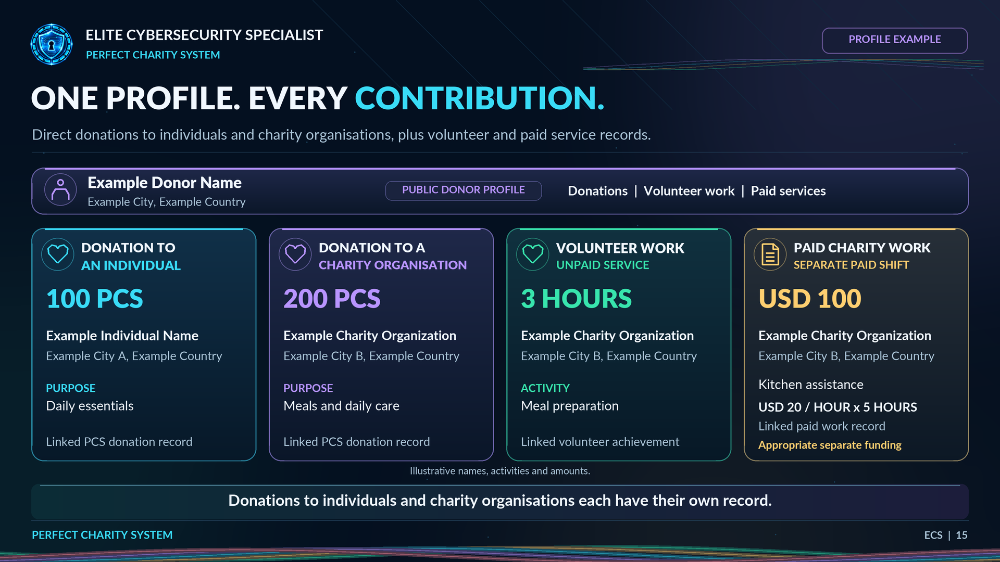
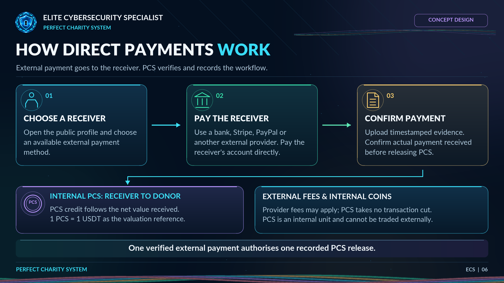
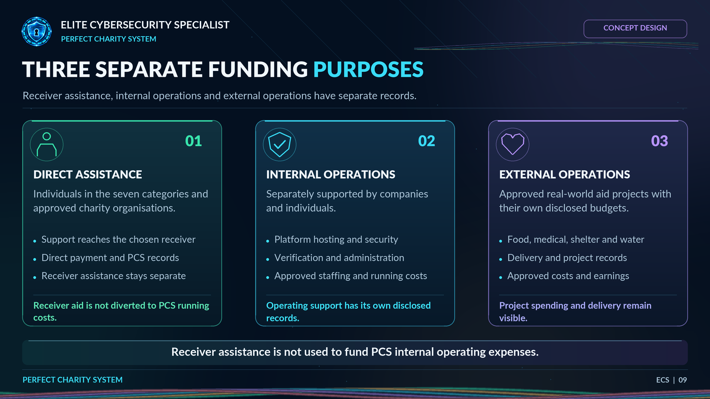
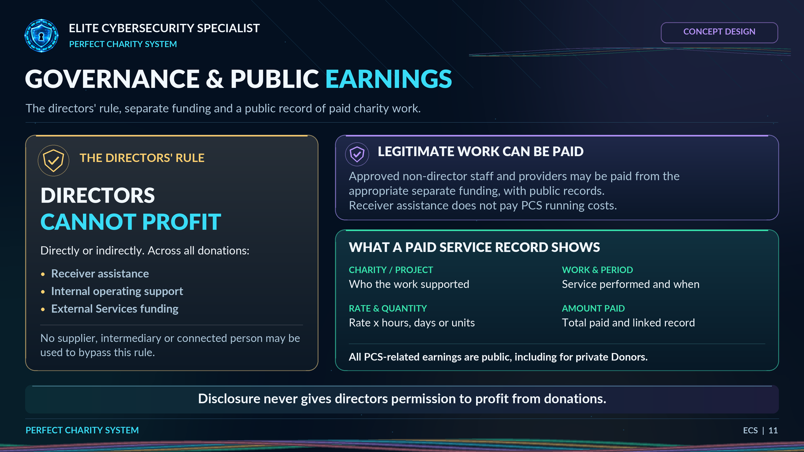
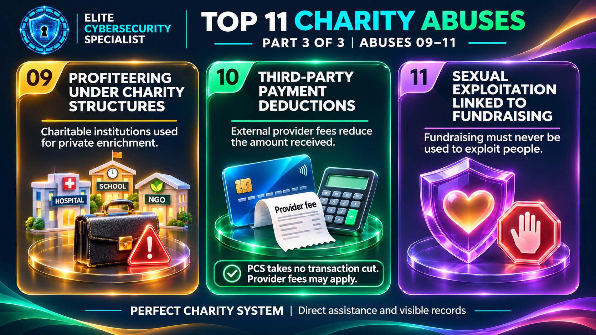

  

# Perfect Charity System (PCS)

**Direct assistance. A traceable contribution. A continuing cycle.**

Perfect Charity System is an initiative by **Elite Cybersecurity Specialist**. The concept was created by **Yuhisern Navaratnam**, with the ambition to achieve the most transparent charity system ever made and minimise world poverty through cooperation, without raising a single sword. Its logic has been refined over ten years.

> **The strength is the logical flow.**
>
> Direct payments, approved Receivers, public contribution histories, internal PCS, separate funding and accountable oversight work together. The objective is to eliminate charity crimes while keeping participation simple.

**Self-funded · Approximately 5% complete.** This README describes the intended operating model. The repository contains prototype code and sample interfaces; completing and validating that implementation is continuing work.

[Logical flow](#logical-flow) · [Profiles](#profiles) · [Seven categories](#receivers) · [Direct payments](#direct-payments) · [Continuing cycle](#continuing-cycle) · [Allocation](#allocation) · [Funding](#funding) · [Governance](#governance) · [Eleven abuses](#eleven-abuses) · [Oversight](#oversight) · [Development](#development) · [FAQs](#faqs)

## 1. The strength is the logical flow

The three central principles connect the entire system:

- **Direct assistance:** the Donor pays the selected Receiver through an available external bank or payment provider.
- **A traceable contribution:** actual payment receipt is confirmed, the related PCS transfer is recorded, and the activity is linked to the relevant profiles.
- **A continuing cycle:** the Donor can give that PCS to another approved Receiver, who can receive a fresh direct payment from the next buyer.

Every stage gives the next stage something to verify:

| Stage | Connected protection |
| --- | --- |
| A Receiver joins. | A PCS representative interviews, verifies and approves the Receiver before the team creates the account. |
| A Donor chooses whom to support. | Public Receiver profiles show their introduction, location and contribution history. |
| Money is paid. | The external provider sends it directly to the Receiver's designated destination. |
| PCS is released. | Actual receipt is confirmed; one external payment authorises one completed transfer from Receiver to Donor. |
| PCS is donated onward. | A separate internal transfer is recorded. Another buyer's fresh payment provides the next external assistance. |
| Operating or project work is paid. | Its funding purpose, work, rate and amount are disclosed. Directors remain prohibited from profiting. |
| An exceptional or privileged action occurs. | Its reason, approving actor and linked records remain reviewable. |

For a Donor, the experience stays simple: **choose a Receiver → pay directly → upload evidence → receive confirmed PCS → donate it onward.**

## 2. Everyone has a profile

The public participants are called **Donors** and **Receivers**. Profiles connect people with their charitable activity, giving practical service and financial support a visible history.

### Donors: public or private

Donors choose whether their profile is public or private. A public profile can show whom they supported, their volunteering and their charity project participation.

A private Donor profile restricts access to that profile. **Contributions remain visible in the Receiver's contribution history, and all required PCS-related earnings remain publicly disclosed.**

### Receivers: public only

Receiver profiles are **always public**. They include the approved name, location, photographs, video, support received and relevant charity activities. Their history shows who donated to them.

Receivers cannot create their own assistance accounts. A representative interviews and verifies them, and the internal team creates the approved account. The team also assists Receivers who need help using PCS.

**Race and religion are not profile fields or assistance categories.**

### One profile, distinct kinds of contribution

Profiles can show:

- **Donations to individuals:** the Receiver, location, amount, purpose and linked contribution record.
- **Donations to charity organisations:** the approved organisation, location, amount, purpose and its own linked contribution record.
- **Help received:** who provided support and the assistance recorded.
- **Unpaid volunteer work:** the activity, organisation or project, service time and volunteer achievement.
- **Paid charity services:** the charity or project, work performed, applicable period, rate, hours or units, amount paid and linked record.
- **Project participation:** roles, work, updates and achievements under PCS.

The example uses **generic participant and location labels**. It shows two separate donation records: **100 PCS to an individual** and **200 PCS to a charity organisation**. Its volunteer record shows **three unpaid hours**; a different work record shows **five hours at USD 20 per hour, totalling USD 100**. These are sample entries for understanding the profile layout.

Someone can volunteer on one occasion and receive legitimate payment for different work on another. Each activity has its own record. **A donation, volunteered time, assistance received and a service payment are never merged into one unexplained contribution or earnings total.**

## 3. Who can receive assistance

Individuals can be approved under seven categories:

1. **Disabilities or special conditions since birth** — people born with disabilities or special conditions.
2. **Acquired physical disabilities** — people who became physically disabled.
3. **Serious diseases** — people suffering from serious diseases.
4. **Abandoned elderly or homeless individuals** — older or homeless people needing assistance.
5. **Orphans under 21** — young people without parental care, below the age of 21.
6. **Single mothers** — unmarried, low-income mothers with children.
7. **Verified refugees** — refugees with verified good conduct and behaviour.

**Approved charity organisations can also receive donations.** They are separate from the seven individual eligibility categories and must accept PCS transparency requirements and operating practices.

Interview-based verification is central to onboarding. The team establishes that the Receiver is real, verifies the applicable circumstances and obtains the required profile material before creating the account. Biometrics are not a prerequisite of this model.

## 4. How Donors pay Receivers directly

### Choose, pay, confirm and record

1. **Choose an approved Receiver.** Read the public profile of an individual or charity organisation, including their location, needs and contribution history.
2. **Choose an available payment method.** Use the Receiver's supported bank or external provider, such as PayPal, Payoneer or Stripe, where available and suitable for that Receiver.
3. **Pay the Receiver directly.** The provider processes the payment to the designated Receiver account. PCS does not build or operate its own fiat payment gateway.
4. **Upload the receipt and confirm actual receipt.** The Receiver or authorised PCS team checks the payment received against the submitted evidence.
5. **Complete the PCS transfer.** The corresponding internal PCS moves **from the Receiver's balance to the Donor's balance**. The purchase, balances, transaction history and profile contribution record must agree.

> **PCS takes no fundraising commission or transaction cut. External bank or provider charges may apply and must be visible.**

A conventional bank account is not a universal PCS requirement. A Receiver can use an eligible supported external payment account. The internal team helps with participation and account setup where needed; availability depends on the provider and location.

### Money and internal PCS have different roles

PCS is the internal charity unit, sometimes called **"dead crypto"**. It can be purchased from approved Receivers and donated within PCS. **It cannot be traded on an external cryptocurrency exchange.**

The valuation reference is **1 PCS = 1 USDT**. Participants can pay through an available local-currency method; payment in USDT is not mandatory. The PCS amount follows the confirmed net value received after external deductions.

The reference is an internal valuation rule. It does not imply a USDT reserve backing every allocation or an external redemption facility. Original currency, provider charges, conversion source, rate, rate time, net receipt and resulting PCS amount must be recorded distinctly. A single published conversion policy remains an implementation decision.

### One payment, one completed release

**The same external payment cannot obtain PCS twice.** Match the original provider transaction reference, original payment time, amount and destination. The receipt-upload time is a separate field; uploading an old receipt again does not create a fresh payment.

The implementation must complete the purchase status, Receiver and Donor balances and ledger entry together, and safely return the existing result if the same completed purchase is submitted again. The [five simple build requirements](#five-build-requirements) keep this rule concrete.

## 5. How the PCS donation cycle continues

Buying PCS already helps the Receiver who receives the direct payment. The Donor can then give the PCS to another approved individual or charity organisation, allowing another buyer to continue the cycle.

1. **Donor A buys PCS from Receiver A.** Donor A pays Receiver A directly. After confirmation, Receiver A transfers the corresponding PCS to Donor A.
2. **Donor A donates that PCS to Receiver B.** Receiver B now holds those units and can make them available to another buyer.
3. **Donor B buys PCS from Receiver B.** This is a **fresh external payment** directly to Receiver B. After confirmation, the PCS transfers from Receiver B to Donor B.
4. **Donor B can donate PCS onward.** The sequence continues with further Receivers and fresh payments from buyers.

### Two fresh payments, 200 USDT assistance, the same 100 PCS

Each purchase in this example has a confirmed **net value of 100 USDT**. The actual payment can use a supported local currency and provider.

| Event | Fresh money received | Internal PCS movement |
| --- | --- | --- |
| Donor A buys from Receiver A. | Receiver A receives 100 USDT net value. | Receiver A → Donor A: 100 PCS. |
| Donor A donates to Receiver B. | No additional external payment at this step. | Donor A → Receiver B: the same 100 PCS. |
| Donor B buys from Receiver B. | Receiver B receives a fresh 100 USDT net value. | Receiver B → Donor B: the same 100 PCS. |

**Two Receivers have received 200 USDT net assistance through two fresh purchases, while the same 100 PCS circulates.** The internal transfers have their own records and are not counted again as new cash assistance.

Each new external payment comes from the next buyer. Allocating or holding PCS alone does not create cash or guarantee when another buyer will participate.

## 6. Monthly PCS allocation

**The standard monthly Receiver allocation is 10,000 PCS**, with **1 PCS = 1 USDT** as the valuation reference.

A Receiver needing additional PCS must explain the need, provide supporting evidence and obtain approval. The request, reason, review, decision and resulting additional allocation must be recorded.

The **monthly allocation**, **accumulated PCS balance** and **external assistance received** are separate records. Balances can accumulate. The standard allocation is not a hard ceiling on the total wallet balance or a promise of monthly cash assistance.

The prototype includes monthly credit and manual addition functions. The full evidence-backed additional-allocation workflow remains development work.

## 7. Separate funding and External Services

PCS keeps three purposes distinct so supporters can see what their contributions fund:

- **Direct assistance:** support for individuals in the seven categories and approved charity organisations. Record the assistance, related PCS transfers and contribution histories.
- **Internal operations:** separately donated support from companies and individuals for hosting, security, maintenance, verification, approved staffing and help for participants. Record the income, spending, payments and available balance.
- **External Services:** approved practical aid projects and delivery costs. Record the responsible profiles, budget, suppliers, spending, delivery, work payments and relevant earnings.

**Donations intended for Receiver assistance do not pay PCS running expenses.** Companies and individuals can donate separately for internal operations. Legitimate work payments use the appropriate separate funding and remain disclosed.

### External Services and practical charity work

External Services is the section for approved physical aid projects. Examples include food and essentials, medical outreach, shelter and homes, water projects and other approved assistance.

Each project identifies its purpose, location, responsible profile, budget, supporting records, suppliers, spending and delivery. It also records the people who participated, which work was volunteered and which services were paid.

Photographs, videos and updates help people understand the work. Volunteer achievements and disclosed paid services become part of participants' charity histories. Giving time and giving money both deserve recognition, with clear records showing the difference.

## 8. Directors and public earnings

**PCS does not profit from donations. Directors cannot profit from any donation, directly or indirectly.**

The prohibition covers **Receiver assistance, internal operating support and External Services funding**. Connected suppliers, intermediaries, nominees or other people cannot be used to bypass it. Public disclosure never gives directors permission to profit.

**All participants' PCS-related earnings must be publicly disclosed through their profiles and relevant records, including for private Donors.**

Approved **non-director staff and providers** can be paid for legitimate work from the appropriate separate funding. Each paid service record identifies:

- The charity or project and its location.
- The person or provider and work performed.
- The applicable date or work period.
- The rate and hours, days or units.
- The total amount paid and payment record.
- The relevant funding purpose, supporting record and relationships.

Assistance received, work earnings and expense reimbursements must be identifiable. No hidden commissions, undisclosed fees or private deductions are permitted. Partners are selected only if willing to follow the required SOPs and transparency standards.

## 9. Eleven charity abuses and the PCS response

PCS is designed to eliminate these abuses through the connected operating rules. Each response combines a restriction with records that allow people to check how the rule was followed.

### Abuses 1–4

1. **Profiting from donations.** Direct Receiver payments and separate operating support keep assistance from being diverted into PCS running costs or directors' personal enrichment. Relevant earnings remain disclosed.
2. **Commission-based fundraising.** PCS takes no fundraising commission or transaction cut. Provider charges are shown separately, and the confirmed net receipt determines the corresponding PCS amount.
3. **Fake employees and ghost payrolls.** Work and payments must identify the person, charity or project, service, period, rate and total paid. Interviewed participants and linked work records make the claim reviewable.
4. **Hidden procurement kickbacks.** Record the supplier, work or goods, price, related parties, payment and delivery. Connected people cannot bypass the directors' prohibition.

### Abuses 5–8

5. **Exploitation of vulnerable people.** The approved Receiver has their own public profile, direct support and internal-team assistance. Donations must not be collected secretly in someone else's name.
6. **Cryptocurrency misuse.** Internal PCS stays within the charity workflow and cannot be traded on outside cryptocurrency exchanges. Allocations, internal transfers and fresh external assistance remain distinguishable.
7. **Lavish fundraising events.** Receiver assistance does not pay event or running costs. Any authorised separately funded spending needs its own purpose, budget and disclosed record.
8. **Money laundering through charity.** Verified participants, payment destinations, actual receipt checks, transaction history and authorised inspection connect the ledger with the external payment evidence for investigation and enforcement.

### Abuses 9–11

9. **Profiteering under charity structures.** Only approved organisations that accept PCS SOPs can participate. Relevant collections, spending, work payments, relationships and earnings must be transparent.
10. **Third-party payment deductions.** External banks and providers can charge fees. PCS exposes those charges and uses the confirmed net receipt; it takes no platform cut. Ordinary disclosed provider charges are costs, not automatically crimes.
11. **Sexual exploitation linked to fundraising.** Exploitation, coercion and using vulnerable people for private gain are prohibited. Safeguarding, reporting, recorded activity and investigation form part of the operating practices.

### A public challenge

**We welcome a public challenge.** If you have a better solution, present it openly. Explain how it addresses these eleven abuses, protects Receivers, keeps assistance separate from expenses and makes charitable spending traceable. Constructive examination helps strengthen the system.

People investigating financial abuse must be able to work safely and independently. We ask the public to support the team's safety, privacy and freedom from intimidation as PCS develops.

**If we do not take action, who will?** Sharing the concept, examining its logic and contributing skills can help turn the intended model into a maintained service.

## 10. Recorded collections and country inspectors

**Each country can have only one inspector account. Its privileged actions must be recorded.**

Inspector accounts are restricted oversight accounts for authorised government and law-enforcement inspection. Their public profiles can be hidden while their actions remain available to authorised review. A country inspector account is separate from the team roles that help Receivers or review exceptional requests.

### Every authorised collection follows PCS

Banks and external providers process the money. **The charitable collection must still follow the PCS workflow and be linked to the PCS records.** Direct payment describes where the money goes; it does not permit unrecorded side collections.

Representatives and partners cannot accept unrecorded cash, undisclosed side payments or separate collections outside the authorised workflow. **PCS treats unauthorised collections as theft under its operating rules**, with investigation, suspension or removal and preservation of the relevant evidence.

### Evidence and transaction history agree

Match external payment evidence, actual receipt confirmation, PCS transfers, balances, allocations and project spending. Receiver approval, extra allocations, payment-destination changes, corrections and inspector actions need identifiable linked records.

The intended blockchain history preserves original transactions. An approved correction uses a **new linked PCS transfer**, with its reason and approval recorded and no PCS return-transfer charge. Any handling of the original external payment follows the external provider's process and is recorded separately.

### Five simple build requirements

The operating logic needs these concrete implementation properties:

1. **One payment, one completion.** Match the original payment, stop duplicate releases and complete the purchase, balances and ledger together.
2. **Verified payment destinations.** Link each destination to the approved Receiver and record any authorised destination change.
3. **Protected inspector access.** Enforce one country account, controlled access and an attributable privileged-action history.
4. **Recorded exceptional approvals.** Additional PCS and corrections require the reason, supporting evidence, decision and approving actor. No approval overrides the directors' no-profit rule.
5. **Verifiable transaction history.** Validate the ledger's links, preserve independently checkable history and reconcile it with balances and external evidence.

The source contains parts of these workflows. Their full enforcement and end-to-end validation belong to the remaining implementation, described in [Simple controls](documentation/pcs-simple-controls.md) and [Development status](documentation/development-status.md).

## 11. Vision and development

PCS brings direct assistance, public Receiver histories, internal PCS circulation, volunteer achievements, disclosed paid work, separate funding and recorded oversight into one model. The aim is to help overlooked people be noticed and supported, recognise practical service and make the use of charitable support understandable.

**PCS is self-funded and approximately 5% complete.** The intended operating model is the direction for development. The current prototype includes profiles, purchase requests, receipts, confirmation, wallet fields, a simple private hash-linked ledger, monthly credits, manual additions, project interfaces and inspector tools.

Completing integration, enforcement of the operating rules, reliable transaction processing and testing remains necessary. The supplied code and interfaces are preserved in this documentation and image release.

### Next priorities

- **Complete the simple participant workflow:** verified Receiver → direct payment → confirmed purchase → recorded PCS transfer → onward donation.
- **Complete profile accountability:** public-only Receivers, Donor visibility choices, contribution histories, volunteer achievements and mandatory paid-service disclosures.
- **Finish the five build requirements:** keep the public experience simple while enforcing the connected rules.
- **Labuan formation:** progress the planned incorporation and governance setup.
- **Guinness World Records campaign:** pursue the ambition of the most transparent charity system in history through an agreed measurable record category, application and independently reviewable evidence.
- **Prepare for wider use:** validate reliability, security, multilingual participation and operations as the service grows.

The world-record programme is a development ambition and campaign objective. Its final record title, criteria and recognition follow the record body's application process.

### Explore the repository

| Topic | Reference |
| --- | --- |
| Donation flow, money and PCS accounting | [PCS model](documentation/pcs-model.md) |
| Profiles, earnings and financial rules | [PCS governance](documentation/pcs-governance.md) |
| Minimum implementation safeguards | [Simple controls](documentation/pcs-simple-controls.md) |
| Current source and remaining implementation | [Development status](documentation/development-status.md) |
| Architecture and responsibilities | [Implementation](documentation/implementation.md) |
| Folder and file guide | [File purposes](documentation/filepurpose.md) |
| Image order and placement | [Image alignment](documentation/image-plan.md) |
| Sample interfaces and application source | [templates/](templates/) · [codes/](codes/) |
| Setup and production preparation | [Deployment](documentation/deployment.md) · [Production preparation](documentation/production.md) |
| Update an existing checkout | [Update GitHub](UPDATE-GITHUB.md) |

## 12. Frequently asked questions

<strong>Can people support individuals and charity organisations?</strong>

Yes. Donors can choose approved individuals or approved charity organisations. Both have public Receiver histories, and the profile example above shows a separate donation to each.

<strong>Who creates Receiver accounts?</strong>

The internal team, after a PCS representative interviews, verifies and approves the Receiver. Receivers do not self-register for assistance; the team helps those who need support to participate.

<strong>What does a private Donor profile hide?</strong>

It restricts access to that profile. Receiver contribution histories still show contributors, and required PCS-related earnings remain public. Receivers have public-only profiles.

<strong>Does PCS run its own bank or fiat payment gateway?</strong>

No. Participants use supported external banks or providers. The money reaches the selected Receiver directly; the evidence, confirmation and corresponding PCS activity follow the PCS workflow.

<strong>Must a Receiver have a conventional bank account?</strong>

An eligible supported external payment account can be used. The team helps with setup and participation, taking the provider's availability and eligibility requirements into account.

<strong>Why buy PCS and then donate it onward?</strong>

The purchase already provides direct assistance to the selling Receiver. Giving that PCS to another approved Receiver lets the next buyer make a fresh direct payment to that Receiver.

<strong>Is PCS traded externally or paid out from an exchange?</strong>

PCS is internal and cannot be traded on outside exchanges. The 1 PCS = 1 USDT rule is its valuation reference. Receivers receive external money from confirmed purchases by buyers.

<strong>Can the same receipt obtain PCS again?</strong>

One original external payment can support only one completed release. Check the transaction reference, original payment time, destination and amount; a different upload time does not make the payment new.

<strong>Are all payments free of provider charges?</strong>

PCS takes no fundraising commission or transaction cut. External providers may charge fees, which must be visible. Corresponding PCS follows the confirmed net value received.

<strong>Does 10,000 PCS each month mean 10,000 USDT cash has arrived?</strong>

The monthly allocation adds internal PCS. Cash assistance arrives through a fresh confirmed purchase. Allocations, accumulated PCS and actual external money received are separate records.

<strong>Can someone volunteer and also be paid for different work?</strong>

Yes. An unpaid volunteer activity and a separate legitimate paid service have distinct records. The paid record shows the charity or project, work, period, rate, quantity and amount paid.

<strong>Can a director profit if the payment is publicly disclosed?</strong>

No. Directors cannot profit directly or indirectly from any donations, including operating and External Services donations. Disclosure does not override that prohibition.

<strong>Can collections happen outside the PCS workflow?</strong>

Unrecorded cash, side payments and separate unauthorised collections are prohibited. External payment processing must be linked to the PCS workflow and records.

<strong>How are mistakes corrected?</strong>

Preserve the original transaction. A management-approved correction creates a new linked PCS transfer, with its reason and approval recorded and no PCS return-transfer charge. External payment handling is a separate provider process.

<strong>What is implemented today?</strong>

The repository contains prototype components and sample interfaces. Software completion is approximately 5%; the [development-status document](documentation/development-status.md) separates components present from the work needed to enforce and validate the intended operating model.

## Connect with Elite Cybersecurity Specialist

**Yuhisern Navaratnam** — Cybersecurity Engineer 
**Elite Cybersecurity Specialist** | Malaysia 
**SSM:** 202403184091 (MA0319303-P)

  

**Email:** [Yuhisern@protonmail.com](mailto:Yuhisern@protonmail.com) 
**WhatsApp:** [+60 17-279 1717](https://wa.me/60172791717) 
**GitHub — Perfect Charity System:** [Official repository](https://github.com/elite-cybersecurity-specialist/perfectcharitysystem) 
**GitHub — ECS projects:** [Elite Cybersecurity Specialist](https://github.com/elite-cybersecurity-specialist) 
**Company profile:** [ECS company profile](https://github.com/elite-cybersecurity-specialist/company-profile) 
**Blogspot:** [Elite Cybersecurity Specialist](https://elite-cybersecurity-specialist.blogspot.com/) 
**TikTok:** [@yuhisern](https://www.tiktok.com/@yuhisern) 
**LinkedIn:** [linkedin.com/in/yuhisern](https://www.linkedin.com/in/yuhisern/) 
**X:** [x.com/yuhisern](https://x.com/yuhisern)
